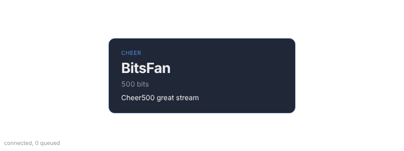

# Phase 0 findings

Phase 0 had one job: prove the risky parts of the plan before building features on them. The plan picked Rust on Cloudflare Workers, one Durable Object per channel, and Twitch EventSub through webhooks. This page says what was tested, how, and what came out.

**Short version:** nothing blocks the plan. Every Durable Object feature we need works from Rust, the bundle is tiny next to the limit, Twitch webhooks verify and route correctly, and alerts survive an OBS reload in a real browser. The one number we still need is burst throughput on real Cloudflare, which needs a Cloudflare account.

All tests below ran on 25 Nov 2026 with workers-rs 0.9.0, wrangler 4.159.0 and Rust 1.97, locally under `wrangler dev` (the same workerd runtime Cloudflare uses).

## 1. Rust Durable Objects in workers-rs

**Result: works.** `ChannelDo` (in `workers/edge/src/channel.rs`) uses all three features the plan depends on.

| Feature | How Sylva uses it | Tested by |
| --- | --- | --- |
| SQLite storage | Event log, alert queue and settings tables | Every e2e check |
| Hibernating websockets | Overlay and feed sockets, with the role stored as a socket attachment so it survives hibernation | Replay, reload and live checks |
| Auto response | `{"type":"ping"}` is answered by the runtime without waking the object, so keepalives are free | Overlay page keepalive |
| Alarms | An alert nobody acknowledges times out after 30 seconds | The 30 second alarm check |

Things worth knowing for later work:

* **`set_alarm(i64)` takes an offset, not a timestamp.** Passing `now + 30_000` scheduled the alarm about 56 years out. The alarm test caught it. The code now passes a `Duration` so the intent is clear.
* Durable Object handlers take `&self`, so in memory state uses `Cell` or `RefCell`.
* SQL integers come back as JavaScript numbers, so row structs read them as `f64`.
* SQL calls are synchronous. That is what makes ordering simple: assigning a sequence number, writing the event and sending it to sockets all happen with no `await` in between, so no other request can slip in.

## 2. WebAssembly bundle size

**Result: no concern.**

| | Size |
| --- | --- |
| WebAssembly module | 484 KB (209 KB gzipped) |
| JavaScript glue | 30 KB |
| Workers limit | 64 MiB uncompressed, all plans |

The plan worried about the old limits of 3 MB (Free) and 10 MB (Paid) compressed. Cloudflare removed those on 4 Sep 2026 and now only checks the uncompressed size against 64 MiB ([changelog](https://developers.cloudflare.com/changelog/post/2026-09-04-increased-worker-size-limit/)). We use under 1 percent of that. The build uses `opt-level = "z"`, LTO and `wasm-opt -Oz`.

The remaining limit to watch is startup time (1 second to run the module's global scope). That can only be measured on Cloudflare. CI reports the bundle size on every pull request and fails above 8 MB, so growth gets noticed long before it matters.

## 3. Twitch EventSub webhooks

**Result: works, with one cross check still to do.** `crates/sylva-core/src/twitch.rs` holds the logic and 15 unit tests. `POST /twitch/eventsub` in the Worker calls it.

* All three message types: `webhook_callback_verification` (replies with the challenge as plain text), `notification`, and `revocation`.
* HMAC-SHA256 signature over message id, timestamp and raw body, compared in constant time.
* Messages older than 10 minutes, or more than 1 minute in the future, are rejected, as Twitch recommends.
* Twitch retries with the same message id. The channel log stores the first and ignores repeats, and still answers 2xx so Twitch stops retrying.
* The channel is found from the subscription's `condition`, which works for conduits (one callback for every channel). Raids use the side the subscription was made for, so an incoming raid is an alert and an outgoing raid is not.
* Normalized so far: follow, sub, resub, gifted sub, community gift, cheer (with anonymous), raid, channel point redemption and chat. Unknown types are kept as `other` with the raw payload, so nothing is dropped.

Still to do: run Twitch's own CLI (`twitch event trigger channel.follow -F <url>/twitch/eventsub -s <secret>`) against the Worker as an independent check of the signature format. Downloading the CLI was blocked in this environment. Our tests sign messages exactly as Twitch documents, but a check against Twitch's own tool is cheap insurance.

## 4. Reliable alerts and replay to an OBS overlay

**Result: works, including a real browser reload.**

How it works:

1. Every event gets the next sequence number (1, 2, 3 and so on, with no gaps) and is written to the channel's SQLite log before it is sent anywhere. The runtime's output gate holds websocket frames and HTTP responses until that write is durable.
2. Alertable events also go into an alert queue table. One alert plays at a time per channel.
3. When an overlay connects, it gets the alert that is playing (or the next queued one). The overlay acknowledges when it has finished showing it. Only then does the next one start.
4. If OBS reloads mid alert, the reconnecting overlay is sent the same alert again. Nothing is lost.
5. Feeds (the dashboard, Cortex) say `lastSeq` when they connect and get every event they missed, in order, then live events.
6. Pause, resume, mute, unmute, skip, replay and "play next" are server state that every client can read (`GET /v1/channels/{key}/state`). This is the state Cortex could never get from StreamElements.

`npm run test:e2e` runs 17 checks against a running Worker, all passing:

* webhook verification, bad signature, old message, revocation
* Twitch retries stored once
* alerts wait while no overlay is connected
* feed replay after `lastSeq`, in order, then live
* overlay gets the oldest alert, an OBS reload shows the same alert again
* a stale ack cannot skip the alert on screen
* pause, resume and mute, skip, replay
* admin token required, bad channel keys refused, percent encoded keys work
* an alert nobody acknowledges times out after 30 seconds through the alarm

A Playwright run of the real overlay page in Chromium showed alert 1, reloaded the page mid alert, and got alert 1 again, then the next one:

## 5. Burst throughput for one channel

**Result: correct under load; the real speed number needs Cloudflare.**

`npm run test:burst` plays a raid against one channel: 90 percent chat, 10 percent follows, plus 2 percent Twitch retries. A feed client stays connected and must receive every event exactly once with seq 1 to N and no gaps.

Local results (wrangler dev, 4 vCPU container, the load generator on the same machine):

| Concurrent senders | Events | Requests per second | p50 | p99 | Every event once, in order |
| --- | --- | --- | --- | --- | --- |
| 10 | 3,000 | 454 | 19 ms | 71 ms | Yes |
| 50 | 5,000 | 603 | 81 ms | 118 ms | Yes |
| 100 | 3,000 | 639 | 148 ms | 313 ms | Yes |
| 200 | 3,000 | 639 | 284 ms | 669 ms | Yes |

How to read this:

* **Correctness held at every level.** No lost events, no duplicates, no gaps, no errors, and retries were dropped.
* **The ceiling here is the local tooling, not the object.** The same setup tops out at about 1,100 requests per second on a route that does nothing at all, and about 750 on a route that only reads the object's state. So these numbers say little about Cloudflare's real capacity.
* Cloudflare documents a soft limit of about 1,000 requests per second per Durable Object and says to load test the real workload ([guidance](https://developers.cloudflare.com/durable-objects/best-practices/rules-of-durable-objects/)). Each Twitch webhook is one request to the object, and chat is the bulk of a raid.

If a real test shows a channel's object running hot, the first lever is to give chat its own object per channel, so alerts never queue behind chat. The ingest path already accepts batches (`/ingest-batch` inside the object) for anything that can be grouped.

## Bugs Phase 0 caught

1. Alarm scheduled 56 years out (the `set_alarm` offset issue above).
2. Browsers encode `:` in `twitch:123` as `%3A`, which made the overlay's socket return 404. The Worker now decodes it, and a check covers it.
3. After the last alert was acknowledged, clients were not told the queue was empty. Now they are.

## Choices made in Phase 0 that you may want to change

* Chat lines go into the same event log as alerts (marked `chat`, never queued as alerts). The plan keeps chat in its own short lived table. Splitting it out later is easy.
* One alert plays at a time per channel, across all overlays of that channel.
* An alert nobody acknowledges times out after 30 seconds.
* POST routes use a single admin token for now. Reads and sockets are open. Real accounts and per overlay read tokens come in Phase 1.

## Not covered yet

* Burst and startup numbers on real Cloudflare (needs an account).
* Creating a real conduit and shard with a Twitch app token (needs a Twitch app).
* Copying events to Postgres through Hyperdrive.

## What needs you

1. **A Cloudflare account** to deploy to and rerun the burst test against. A `workers.dev` address is fine for now.
2. **A Twitch application** (client id and secret from the Twitch developer console) to create a real conduit and point a webhook shard at the Worker.
