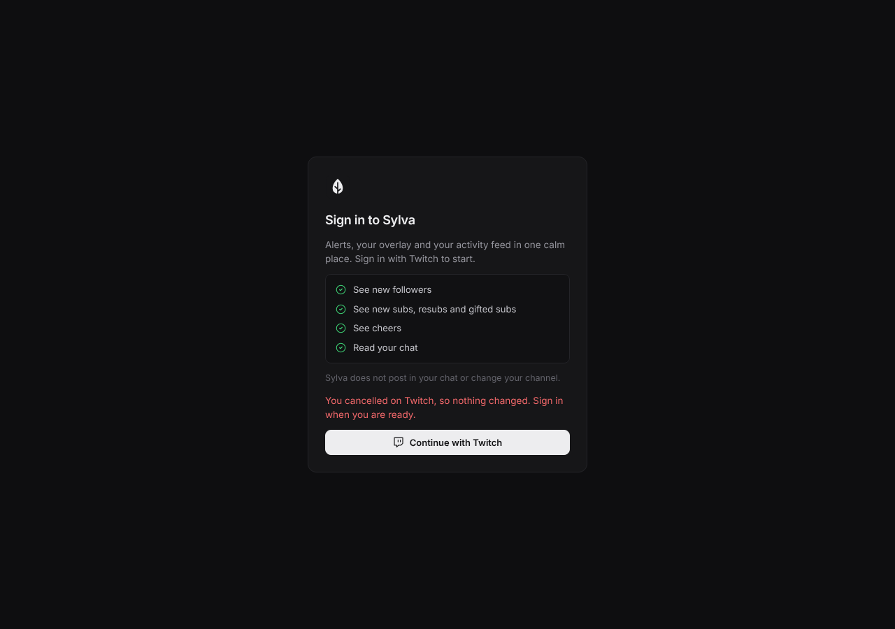
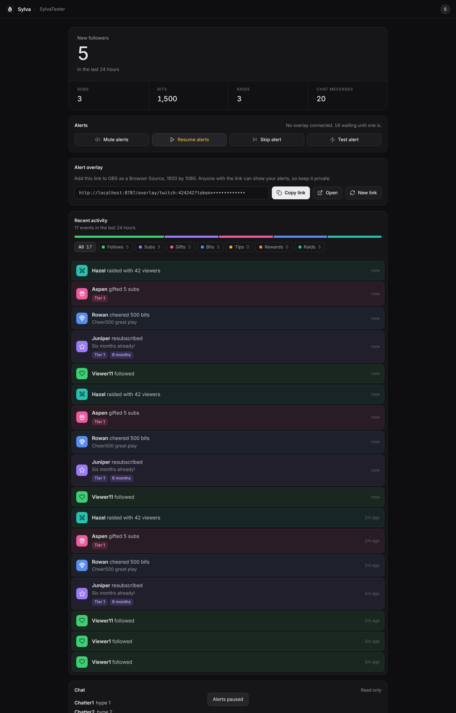

# Phase 1, part 1: sign in, live Twitch events and the dashboard

Phase 1 is the MVP: a streamer can replace StreamElements for alerts, overlays and the activity feed. This first part does what everything else in Phase 1 stands on. A streamer signs in to Sylva with Twitch, and from then on their follows, subs, cheers, raids and chat reach Sylva, play as alerts on an overlay in OBS, and show on a dashboard in Cortex's design.

## What a streamer sees

1. **Sign in.** One button, Continue with Twitch. The page lists what Twitch will ask to allow, in plain words: see new followers, see new subs, see cheers, read your chat. If something goes wrong (cancelled on Twitch, a stale link, a missing permission) the page says what happened and what to do.
2. **The dashboard.** Cortex's one column layout and design system, unchanged:
   * New followers in the last 24 hours as the big number, with subs, bits, raids and chat messages under it. These are counted on the server, so they are right however busy the channel is.
   * **Alerts**: mute, pause, skip and a test alert. The buttons show the real state (muted or not, paused or not), plus what is playing, how many wait and how many overlays are connected. This is the state Cortex could never read from StreamElements.
   * **Alert overlay**: the link for OBS, hidden until copied, with Open and New link. A new link disconnects every overlay using the old one at once.
   * **Recent activity**: Cortex's feed with its colors, mix bar and filters, live, with Replay on every alert and Show older for history.
   * **Chat**: read only, live, and it stops scrolling while you scroll up.
   * **Twitch events**: which events are on. If one is off, Turn on again fixes it, and if Twitch says Sylva lost permission it offers Sign in again.
3. **The overlay** in OBS plays one alert at a time, survives reloads (from Phase 0), and now needs its link's token.

## How it works

* **Sign in** is Twitch's authorization code flow with a confidential client, so the client secret never leaves Cloudflare. A random `state` in a 10 minute cookie stops forged callbacks. Sylva asks for `moderator:read:followers`, `channel:read:subscriptions`, `bits:read`, `user:read:chat`, `user:bot` and `channel:bot`, the minimum for follows, subs, cheers and chat with an app token on the conduit.
* **Accounts** follow decision 11: a Sylva account with linked identities. `AccountDo` (one per account) keeps the Twitch identity, its tokens encrypted with AES-256-GCM, the sessions, and the channels the account owns. `DirectoryDo` maps a Twitch user to their account, so signing in again finds the same account.
* **Sessions** are a cookie holding `<account id>.<secret>`, HttpOnly and SameSite=Lax, for 30 days. The account stores only a SHA-256 hash of the secret. Signing out deletes it. Requests that change something with the cookie must also come from Sylva's own pages (`Origin` check).
* **Events**: after sign in, the Worker subscribes the channel on the app's conduit to follows (v2), subs, resubs, gifts, cheers, chat, raids, going live, going offline and channel updates. A 409 from Twitch means the subscription exists already and counts as success.
* **Access to a channel**: its owner (cookie) or the admin token. An overlay link's token opens the socket as an overlay only. It gets no history and cannot connect as a feed, so a leaked OBS link does not leak chat or the event log. The Worker always sets the internal access header itself and strips any copy a client sends.
* **The dashboard** is React and TypeScript in `web/`, built by Vite and served by the same Worker as static assets, so sign in, the API and the dashboard share one origin and need no CORS. Its stylesheet is Cortex's `styles.css` with a few additions at the end.

## Fixed along the way

* **Gifted subs played too many alerts.** Twitch sends one `channel.subscription.gift` plus one `channel.subscribe` per recipient, and Phase 0 alerted on both, so 10 gifted subs would play 11 alerts. Now the gift plays once and each recipient only goes in the feed.

## Tests

* 31 unit tests in `sylva-core`, 10 of them new: sign in scopes, cookies, sessions, token encryption, the subscription list and gift alerts.
* `npm run test:e2e` now runs 37 checks. The 20 new ones cover overlay links, history, summaries, gifts, locked reads, and the whole sign in flow against `tools/fake-twitch.mjs`: state checks, cancel, missing permissions, account reuse, subscriptions made, the Origin check, the owner's socket, Twitch status, and sign out. CI runs them on every pull request.
* The dashboard was driven in Chromium with Playwright at desktop and phone width (390 px, no sideways scrolling): sign in through the fake Twitch, live events, pause, the overlay link playing an alert.
* The burst test still delivers every event once and in order.

## Worth your review

* **Accounts live in Durable Objects, not Postgres yet.** The plan puts accounts in Postgres through Hyperdrive. Nothing in Phase 1 needs a query across accounts, and Postgres needs a hosted database first, so this waits until the first feature that does. Moving is straightforward.
* **Chat is read as the broadcaster** (`user_id` is the broadcaster), which is why `user:bot` and `channel:bot` are asked at sign in. The shared Sylva bot account from the plan comes with the chatbot in Phase 2.
* **The hero number is new followers in the last 24 hours.** Cortex shows viewers there. Viewer counts can come once Sylva reads stream sessions.
* **Overlay links replace the open Phase 0 overlay.** An overlay URL without a token stops working.

## What is next in Phase 1

In plan order: the overlay editor with widgets (alerts, event list, goal bar, labels, chat box) and starter templates, history search, the device code sign in and public API for Cortex, and Cortex's Sylva provider in beta.
