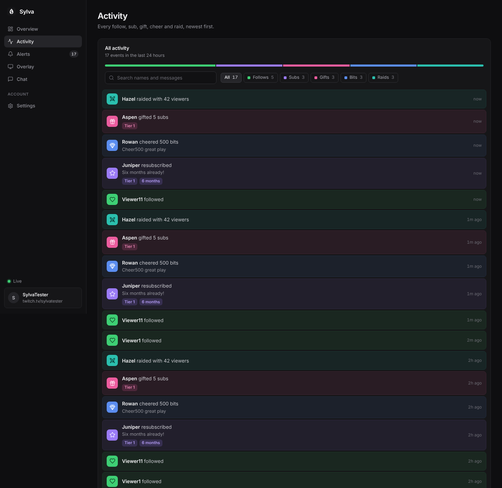
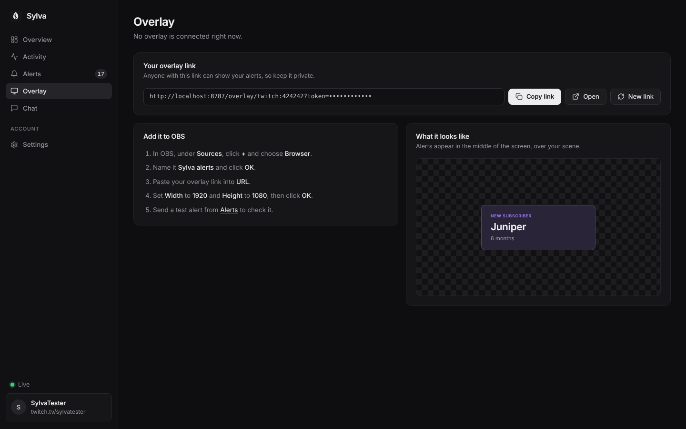
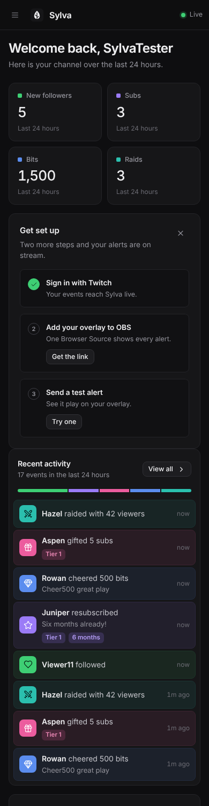
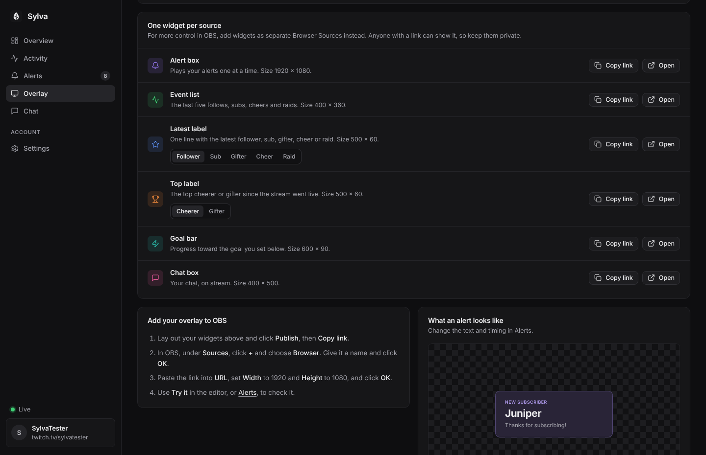

# The Sylva website

Sylva is a website, not a desktop window. It has two parts, served by the same Worker from one origin.

## The landing page, `/`

What Sylva is, what it does, and three steps to start, with Continue with Twitch at the top and bottom. If a sign in fails, the reason shows under the button. Signed in visitors see Open dashboard instead. Unknown pages show a short Page not found.

## Other public pages

* `/privacy`: what Sylva keeps, why, who can see it, where it is stored, and how to delete it. Linked from every public page's footer and from Delete account.
* `/device`: where a streamer approves an app such as Cortex (see [api.md](api.md)).

## Deleting an account

Settings, Delete account, then type the Twitch name to confirm. `POST /v1/account/delete` (browser session and same origin only; the body is `{"confirm": "<twitch login>"}`):

1. Asks Twitch to stop every EventSub subscription for the user. If Twitch does not confirm, nothing is deleted and the page says to try again.
2. Erases the account (identities, sessions, API tokens), every channel it owns (events, alerts, settings, goal, overlay links; open overlays are closed) and its directory entries, so signing in again starts a fresh account.
3. Revokes the Twitch token and clears the cookie. The browser lands on `/` with a note that the account was deleted.

## The dashboard, `/app`

A sidebar with the pages, the live connection and the signed in channel. On phones the sidebar becomes a drawer behind a menu button. Every page has its own address, so links, reloads and the back button work. Visiting `/app` signed out goes to the landing page, and signing in lands on `/app`.

| Page | Path | What it is for |
| --- | --- | --- |
| Overview | `/app` | The last 24 hours (followers, subs, bits, raids), a setup checklist until the overlay and a test alert are done, recent activity, alert controls and chat. |
| Activity | `/app/activity` | Every event, newest first, with filters by kind, search by name or message, and Show older. Search runs on the server, so it covers all history. |
| Alerts | `/app/alerts` | Mute, pause and skip; alert types (on or off, minimum amount, time on screen, label and message, with a live preview); a test alert for each kind; Replay on recent alerts. |
| Overlay | `/app/overlay` | Links for the alert box and the widgets (event list, latest label, goal bar, chat box), each with Copy and Open; New links; the goal; and the steps for OBS. |
| Chat | `/app/chat` | Chat, live and read only. |
| Settings | `/app/settings` | The account and Sign out, the theme (Dark, Light or System), connected apps, which Twitch events reach Sylva, and Delete account. |

## Design

The look takes Cortex's ideas, not its layout: neutral grays, one color per kind of event used everywhere that kind appears, flat cards with 1 px borders, Inter with tabular numbers, a white primary button, and short calm motion. Dark is the default. The light theme uses the same tokens with lighter values, and the choice is applied before the page paints, so it never flashes.

## How it was checked

* Accessibility: axe finds no WCAG 2.1 AA issues on 34 page states (every page in both themes, the alert editor, search, device approval, the phone drawer, privacy and the delete form). Text contrast is at least 4.5 to 1. The phone drawer moves focus in and back out and makes the page behind it inert.
* Security headers: the website sends a Content-Security-Policy with its one inline script allowed by hash, `X-Frame-Options: DENY`, `Referrer-Policy` and `Permissions-Policy`. `app.js` and `index.css` are linked with a content hash and cached for a year.

* Every page driven in Chromium with Playwright at 1440 px and at 390 px (phone), in both themes: sign in through the fake Twitch, live events, search, theme change, the phone drawer, and sign out. No page scrolls sideways on a phone.
* `npm run test:e2e` adds a check for history search: names and messages match regardless of case, and `%` and `_` are taken literally.

## Alert types

Each kind of alert (follows, subs, gifted subs, cheers, raids, tips, channel points) has:

* **On or off.** Off still records the event in Activity; it just does not play.
* **Play from** a minimum amount, for kinds with an amount: bits, raid viewers, subs in a gift, tip amount. Smaller ones only go to Activity.
* **On screen for** 2 to 20 seconds.
* **Label and message.** The message can use `{name}`, `{amount}` and, for channel points, `{reward}`.
* **Show what the viewer wrote**, for cheers, subs and tips.

The channel applies these on the server (`crates/sylva-core/src/alerts.rs`): it decides what goes into the queue, and every `play` frame carries the finished text and time on screen, so all overlays show the same thing and old overlay links need no change. A `duration` in an overlay link still overrides the time for that overlay. Test alerts follow the settings too, and the dashboard says when a test only went to Activity.

## Widgets

Every widget is the overlay page with `&widget=` added to the same private link, so one token covers them all and New links replaces them all at once. Each is its own Browser Source in OBS, at the size the dashboard shows.

| Widget | Link adds | Shows |
| --- | --- | --- |
| Alert box | nothing | Alerts, one at a time, as set in Alerts. |
| Event list | `&widget=feed` (`&limit=` 1 to 20, default 5) | The newest follows, subs, gifts, cheers, raids, tips and redemptions. |
| Latest label | `&widget=latest&kind=follow` (or `subscriber`, `communityGift`, `cheer`, `raid`) | One line with the latest of that kind. |
| Goal bar | `&widget=goal` | The goal set on the Overlay page: followers, subs (new, resubs and each gifted sub) or bits, counted from when it was started. |
| Chat box | `&widget=chat` (`&limit=` 1 to 30, default 12) | Chat lines as they arrive. |

Widgets connect with the `widget` role: on connect they get a `widgets` frame (recent events, the latest of each kind, recent chat and the goal with its progress) and then follow live `event` frames. They never receive `play` frames and do not count as connected alert boxes, so they cannot hold up the alert queue. Saving the goal sends a fresh `widgets` frame to every widget on screen. The goal lives in `GET` and `POST /v1/channels/{key}/widget-settings`.

