# The Sylva website

Sylva is a website, not a desktop window. It has two parts, served by the same Worker from one origin.

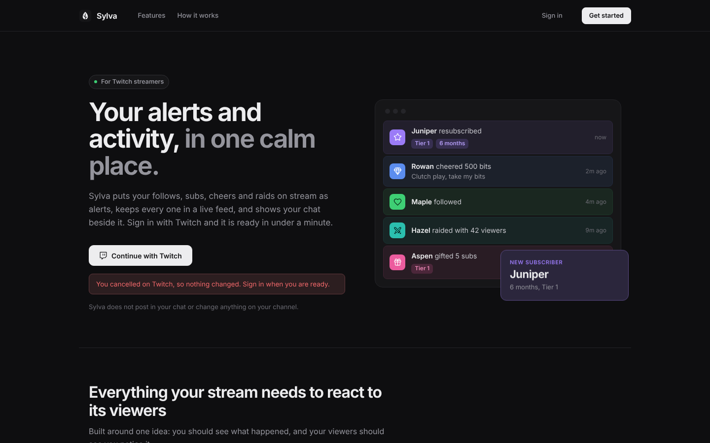

## The landing page, `/`

What Sylva is, what it does, and three steps to start, with Continue with Twitch at the top and bottom. If a sign in fails, the reason shows under the button. Signed in visitors see Open dashboard instead. Unknown pages show a short Page not found.

## Other public pages

* `/privacy`: what Sylva keeps, why, who can see it, where it is stored, and how to delete it. Linked from every public page's footer and from Delete account.
* `/device`: where a streamer approves an app such as Cortex (see [api.md](api.md)).

## Deleting an account

Settings, Delete account, then type the Twitch name to confirm. `POST /v1/account/delete` (browser session and same origin only; the body is `{"confirm": "<twitch login>"}`):

1. Asks Twitch to stop every EventSub subscription for the user. If Twitch does not confirm, nothing is deleted and the page says to try again.
2. Erases the account (identities, sessions, API tokens), every channel it owns (events, alerts, settings, goal, overlay links; open overlays are closed) and its directory entries, so signing in again starts a fresh account. It leaves every team it was on, and its own channels' teams lose access at once.
3. Revokes the Twitch token and clears the cookie. The browser lands on `/` with a note that the account was deleted.

## The dashboard, `/app`

A sidebar with the pages, the live connection and the signed in channel. On phones the sidebar becomes a drawer behind a menu button. Every page has its own address, so links, reloads and the back button work. Visiting `/app` signed out goes to the landing page, and signing in lands on `/app`.

| Page | Path | What it is for |
| --- | --- | --- |
| Overview | `/app` | The last 24 hours (followers, subs, bits, raids, each with a 7 day trend line), a setup checklist until the overlay and a test alert are done, recent activity, alert controls and chat. |
| Stats | `/app/stats` | The last 7, 30 or 90 days against the period before: followers, subs and gifts, bits, chat messages, unique chatters and viewers, each with its trend. A day by day chart for each, viewers over time (sampled from Twitch every 5 minutes while live), community growth by kind, every stream side by side (sortable), top chatters, cheerers, gifters and raiders, the commands used most, and when chat is busiest by weekday and hour. Worked out from the event log by `GET .../stats?days=&tz=`. |
| Activity | `/app/activity` | Every event, newest first, with filters by kind, search by name or message, and Show older. Search runs on the server, so it covers all history. |
| Alerts | `/app/alerts` | Mute, pause and skip; alert types (on or off, minimum amount, time on screen, label and message, with a live preview); a test alert for each kind; Replay on recent alerts. |
| Overlay | `/app/overlay` | The overlay editor (every widget on one canvas, published to one link), the goal, single widget links for anyone who prefers one source per widget, New links, and the steps for OBS. |
| Chat | `/app/chat` | Chat, live and read only. |
| Chat bot | `/app/bot` | Turn the bot on, edit its commands, timers, counters and quotes, and a test chat that shows what it would answer. |
| Chat alerts | `/app/chat-alerts` | The bot announces subs, resubs, gifted and mass gifted subs, raids, bits, charity donations, ad breaks, hype trains, going live, game and title changes, predictions, polls, follows and watch streaks in chat. Each has a switch, a message of up to 500 characters with its `${variables}`, and minimums for raids, bits, charity and watch streaks. Everything starts off. YouTube and Kick tabs say coming soon. Charity, ads, hype trains, predictions and polls need Allow alerts (`/auth/twitch/start?scopes=alerts`). |
| Moderation | `/app/moderation` | How strict chat rules are (Off, Relaxed, Standard, Strict or Custom), each rule with its limits, banned words and allowed sites, a box to try a message, and the log of what Sylva did with Lift timeout. |
| Loyalty | `/app/loyalty` | Turn points on, name them, set what each way of earning pays, the chat commands, and every viewer with their balance, history and a way to add or take away points. |
| Store | `/app/store` | The queue of redemptions waiting (Done, Refund, and History with Not done), the rewards with their cost, stock, wait and message, opening the store, and the public page's link. |
| Giveaways | `/app/giveaways` | Starting a giveaway (prize, chat word, who can enter, subscriber luck, entry cost), the current one with its entries, Close entries, Draw a winner, Draw another, Finish and Cancel, and past giveaways with the seed that proves each draw. |
| Settings | `/app/settings` | The account and Sign out, the team (owner only), the theme (Dark, Light or System), connected apps, which Twitch events reach Sylva, and Delete account. |

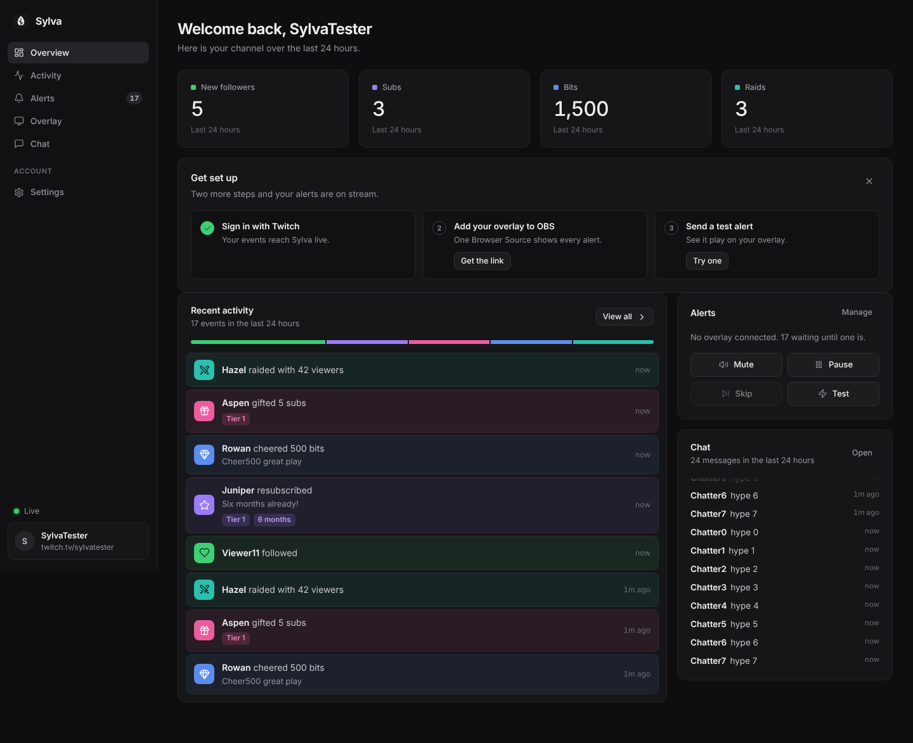

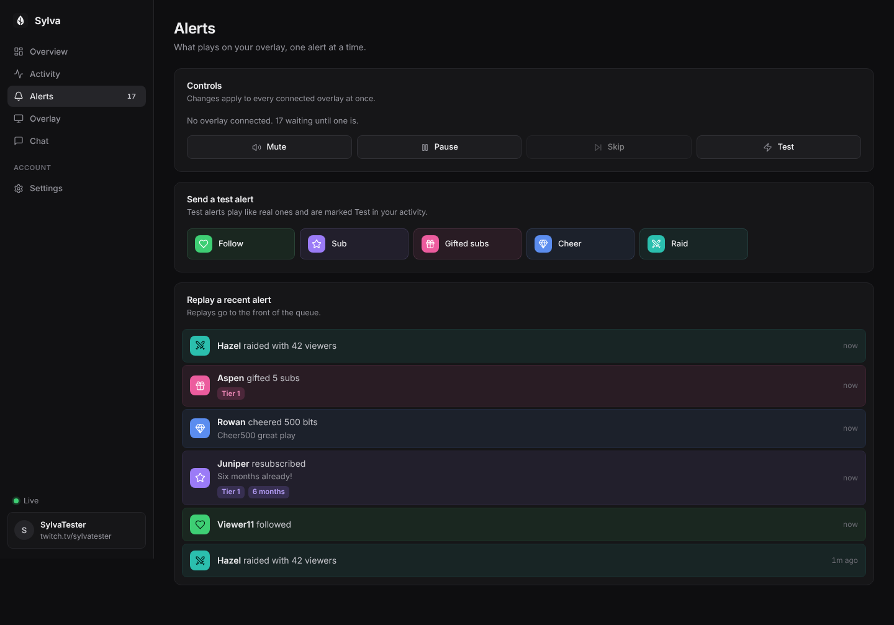
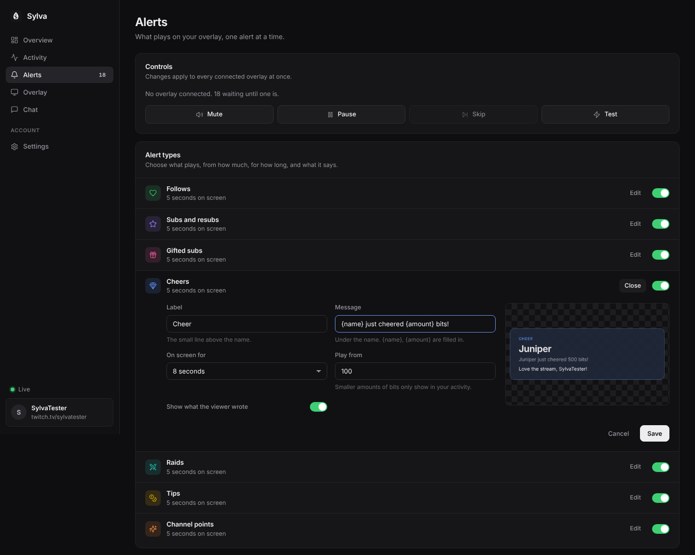

## Design

The look takes Cortex's ideas, not its layout: neutral grays with soft depth (a faint glow behind the page, gentle card shadows), a sidebar grouped into Home, Stream, Bot, Community and Account, a breadcrumb bar with the live status, one color per kind of event used everywhere that kind appears, flat cards with 1 px borders, Inter with tabular numbers, a white primary button, and short calm motion. Dark is the default. The light theme uses the same tokens with lighter values, and the choice is applied before the page paints, so it never flashes.

## How it was checked

* Accessibility: axe finds no WCAG 2.1 AA issues on 96 page states (every page in both themes, the alert editor, the overlay editor with each menu open and a widget selected, the chat bot with a command open, a new command, the test chat, a timer open and a new timer, a new counter and a new quote, moderation with unsaved changes and a tried message, and moderation off, loyalty with unsaved changes and a viewer open, the store with a new reward open and its history, giveaways running, starting and with a past seed shown, a moderator's view of eight pages, the public points page and its not found page, search, device approval, the phone drawer, privacy and the delete form). Text contrast is at least 4.5 to 1. The phone drawer moves focus in and back out and makes the page behind it inert.
* Security headers: the website sends a Content-Security-Policy with its one inline script allowed by hash, `X-Frame-Options: DENY`, `Referrer-Policy` and `Permissions-Policy`. `app.js` and `index.css` are linked with a content hash and cached for a year.

* Every page driven in Chromium with Playwright at 1440 px and at 390 px (phone), in both themes: sign in through the fake Twitch, live events, search, theme change, the phone drawer, and sign out. No page scrolls sideways on a phone.
* `npm run test:e2e` adds a check for history search: names and messages match regardless of case, and `%` and `_` are taken literally.
* It checks the chat bot against the fake Twitch: off by default, levels, cooldowns, moderators skipping them, aliases, counts a save cannot change, echoes ignored, the test chat sending nothing, moderation (permission missing, allowing it, refreshing an expired token, keeping it after a plain sign in, delete then timeout, who is skipped, spaced notices, lifting a timeout, and refusing to undo a removed message), counters and quotes (only moderators change them, values a save cannot reset, numbers never reused, Undo restoring a quote's number, the test chat changing nothing, quotes turned off), and timers (refused variables, waiting for chat lines and for going live, going live restarting them, Send now, the bot's own posts not counting as chat, and Send now refused while the bot is off), and loyalty points (one follow bonus however often someone follows, subs, gifts and cheers, watch and chat points paid only while live, viewers who only watch paid once the chat list is allowed, the streamer never paid, `!points`, `!top`, `!give` with too few points, `!addpoints` for moderators only and for viewers Sylva has not seen yet, balances stopping at zero, the dashboard's search, changes and history, and turning points off), and the points store (names chat would misread refused, `!store` with the public link, a reward that needs a message, the wait between buys, sold out, too few points, an unknown reward, done, not done and refund with the points and stock given back, the public page and its viewer lookup, the test chat, and closing the store), and giveaways (chat words Sylva already uses refused, one entry per viewer, the streamer kept out, subscriber luck, an entry cost with too few points said once, a draw anyone can repeat from the seed, no one winning twice, closing entries, and cancelling with the costs given back), and team roles (unknown names, the owner and the owner role refused, someone added before they sign in, an editor changing settings but not the team or the overlay link, a moderator limited to the live parts, a viewer only looking, role changes applying at once, removal taking the channel away even after signing in again, and teammates losing a deleted owner's channel). When a timer is due is covered by unit tests.
* It also checks the overlay editor (bad layouts are refused, drafts are tidied, publishing pushes the layout to overlays on screen, versions and restore work) and top labels (cheers add up per viewer and reach widgets live).

## Alert types

Each kind of alert (follows, subs, gifted subs, cheers, raids, tips, channel points) has:

* **On or off.** Off still records the event in Activity; it just does not play.
* **Play from** a minimum amount, for kinds with an amount: bits, raid viewers, subs in a gift, tip amount. Smaller ones only go to Activity.
* **On screen for** 2 to 20 seconds.
* **Label and message.** The message can use `{name}`, `{amount}` and, for channel points, `{reward}`.
* **Show what the viewer wrote**, for cheers, subs and tips.

The channel applies these on the server (`crates/sylva-core/src/alerts.rs`): it decides what goes into the queue, and every `play` frame carries the finished text and time on screen, so all overlays show the same thing and old overlay links need no change. A `duration` in an overlay link still overrides the time for that overlay. Test alerts follow the settings too, and the dashboard says when a test only went to Activity.

### Alert sounds and images

Each alert type can have an uploaded sound (MP3, OGG, WAV) with its volume and
an image or GIF (PNG, JPG, GIF, WebP), up to 3 MB each and 30 files, 40 MB per
channel. Files are checked by their first bytes, kept in the channel's own
SQLite in pieces, and served at `/media/{channel}/{id}` with a year of
caching and a sandbox CSP. The overlay plays the sound, and the alert box shows
the image; custom alert widgets get `view.soundUrl` and `view.imageUrl`.
Deleting a file takes it out of every alert that used it.

## Stream summaries

When a stream goes offline the channel works out its summary from the event
log (followers, subs, gifted subs, bits, raids, tips, redemptions, chat lines,
people who chatted, and the top chatter, cheerer and gifter) and keeps the
last 60. The Overview page shows the live stream so far, or the last one, with
earlier streams in a picker. `GET /v1/channels/{key}/streams`.

## The overlay editor

The top of the Overlay page. Every widget sits on one 1920 by 1080 canvas, and the whole layout is one Browser Source in OBS: the overlay link with `&scene` added.

* **Add widget** places an alert box, event list, latest label, top label, goal bar or chat box (one alert box per layout). **Templates** starts from Gameplay, Just chatting or Minimal. **Try it** sends a test event, so an open overlay shows the alert and its labels update. The previews on the canvas use example names.
* Drag to move, pull a corner to resize. Widgets snap to the canvas edges and centers and to each other, with guides; hold Alt to place freely. Arrow keys nudge by 1 px (Shift for 10), Delete removes, Escape deselects, and Undo and Redo work with Ctrl+Z and Ctrl+Shift+Z.
* The panel beside the canvas sets exact position and size, the kind for latest and top labels, how many rows for the event list and chat, and the stacking order.
* Changes save as a draft on their own. **Publish** makes a new version and every open overlay switches to it at once. **History** keeps the last 20 published versions; Restore to draft brings one back to check before publishing it again.

The draft and versions live in the channel's Durable Object (`GET /v1/channels/{key}/scene`, `POST .../scene` for the draft, `POST .../scene/publish`, `POST .../scene/restore/{version}`). The server checks every layout: known widgets only, unique ids, sizes kept on the canvas, at most 24 widgets.

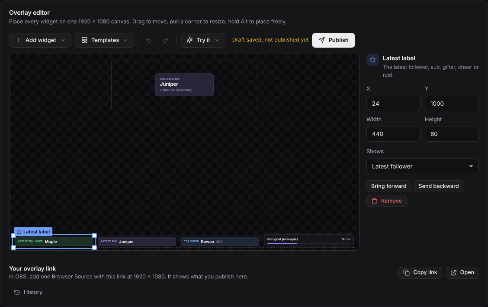

## The chat bot

Off until the streamer turns it on. When a chat line starts with `!` and names a command, the channel's Durable Object checks who may use it and its cooldowns, counts it, writes the reply and sends it with Twitch's Send Chat Message API and Sylva's app token. The `user:bot` and `channel:bot` scopes granted at sign in are what Twitch needs for that, and the reply shows Twitch's Chat Bot badge.

* **Who replies.** Sylva's shared bot account, `sylva_bot`, in every channel, with Twitch's Chat Bot badge. It needs no setup from the streamer: the `channel:bot` permission given at sign in lets it chat there without being a moderator, and its own lines are never read as commands. The account is set with `SYLVA_BOT_USER_ID` and `SYLVA_BOT_LOGIN` (sign in to it at `/auth/twitch/bot`, which asks only for `user:bot` and `user:write:chat`, the two Twitch requires of a sender, to see the two values). Left empty, as in the local tests, the streamer's own account replies instead.
* **Commands.** Every channel starts with `!commands`, `!uptime`, `!lurk` and `!so` (moderators), which are ordinary commands to change or delete. A command has other names, a reply of up to 500 characters, who may use it (everyone, subscribers, VIPs, moderators, or only the streamer) and cooldowns for everyone and per viewer. Moderators skip cooldowns. Up to 100 commands.
* **Variables** use StreamElements' style so imported commands keep working: `${user}`, `${touser}`, `${1}` to `${9}`, `${args}`, `${channel}`, `${count}`, `${uptime}`, `${random.1-100}` and `${commands}`. A reply with `${uptime}` while offline says the channel is offline. Unknown variables are refused when saving.
* **Test chat** runs a line through the same code on the server without sending it, as a viewer, subscriber, VIP, moderator or the streamer. The editor's preview uses it too, with the unsaved command.
* **Echoes.** The bot remembers what it sent for a minute, so its own reply coming back through chat is never read as a command.
* Deleting a command or a timer offers Undo.

### Timers

Messages the bot posts on a schedule, such as a follow reminder or a Discord link. Up to 20.

* **When.** Every 5 minutes to 3 hours, and only once at least a set number of chat lines (0 to 100) have been sent since the last post, so the bot never talks to an empty room. Lines the bot sent itself do not count. A timer can post only while live (the default) or at any time.
* **How.** The channel's Durable Object keeps one alarm for both alerts and timers, set for whichever is due first. Due timers post one at a time, at least 30 seconds apart. Going live restarts every timer's clock, so nothing fires the moment a stream starts.
* **Variables.** `${channel}`, `${uptime}`, `${commands}` and `${random.1-100}`. Variables about a viewer are refused, because no viewer started the message.
* **The list** shows each timer's rule and what it waits for: the next post time, more chat lines, going live, or the bot being turned on. Send now posts it at once and restarts its clock.

### Counters and quotes

* **Counters** are numbers chat can see, such as deaths. `!deaths` shows `Deaths: 6` (at most every 5 seconds, except for moderators). Moderators change it with `!deaths +`, `!deaths -2`, `!deaths = 10` or `!deaths reset`; the dashboard has minus and plus buttons and the number itself. Up to 30. The value is the server's, so a settings save cannot reset it.
* **Quotes** are numbered: `!quote` picks one at random, `!quote 12` shows that one, `!quote word` picks among the quotes that mention the word, the speaker or the game. `!addquote words` adds one (with the game Twitch last reported) and `!delquote 12` removes one; moderators may by default, and the page can change that. Numbers are never reused. The dashboard lists, searches, adds, edits and removes quotes, with Undo putting a quote back under its number. Up to 2,000.
* A counter or quotes cannot share a name with a command; the save says which to rename.

`GET` and `POST /v1/channels/{key}/bot` hold the settings (use counts and counter values are the server's and a save cannot change them); `POST .../bot/try` is the test chat; `POST .../bot/timers/{id}/send` is Send now.

### Built-in commands

Every channel has these without writing a reply (the list is `sylva_core::builtins::BUILTINS`). Each has its own switch, who may use it and a cooldown on the Bot page, and a command or counter of the streamer's with the same name replaces it.

* **Stream info:** `!commands` (links to the public page `/c/{login}`), `!uptime`, `!game`, `!title`, `!gamesplayed`, `!followage`, `!followsince`, `!accountage`, `!accountsince`, `!ping`.
* **Fun:** `!8ball`, `!dadjoke`, `!fact`, `!dictionary`, `!urbandictionary` (off at first, its answers can be rude), `!emotes` (Twitch, 7TV, BetterTTV and FrankerFaceZ; moderators type `!emotes reload`).
* **Commands and counters** (moderators): `!addcmd`, `!editcmd`, `!setcmd`, `!delcmd`, `!command add|edit|set|delete|on|off|show`, and `!count` for counters. Built-in names cannot be added or deleted from chat.
* **Quotes:** `!quote`, `!addquote`, `!editquote`, `!deletequote` (also `!delquote`). The Quotes switch on the Bot page still turns them all off.
* **Your stream:** `!clip`, `!settitle`, `!setgame`. These and the follow commands need the streamer's **Allow** on the Bot page (Twitch scopes `clips:edit`, `channel:manage:broadcast` and `moderator:read:followers`, kept as the `commands` grant).
* **Moderation:** `!permit` (skip the chat rules for 60 seconds), `!nuke` (works like Fossabot's: `!nuke <phrase or /regex/> [-r=5m] <scrollback> <timeout, delete or ban>`, such as `!nuke bad phrase 3m 10m`; scrollback up to 10 minutes, `-r=` radiation up to an hour catches new matching messages too; moderators are left alone; nothing is said in chat, and every action lands in the Moderation log, where timeouts can be lifted and bans undone), `!vanish`, `!votekick` (off at first; 5 votes in a minute time someone out for 5 minutes), `!filesay` (the streamer only by default; up to 25 lines, one every 2 seconds) and `!filesaystop`. All but the last two need Allow moderation.

Song request and media queue commands are left out on purpose. Settings saved before built-ins existed are upgraded on first read: the old default `!commands` and `!uptime` replies make way for the built-in ones, and the quote commands take the old "who can add quotes" level.

### Moving from StreamElements

Settings has **Move from StreamElements** for the owner: paste the StreamElements JWT token (Account, Channels, Show secrets) and pick commands, timers and loyalty points. Sylva calls StreamElements' API once with it and never stores it. Commands come over one at a time, so one Sylva cannot keep (an unknown variable, a name already used) is listed with the reason instead of stopping the rest; common variables such as `${user.name}` are renamed. A timer that rotates several messages becomes one timer per message. Points and watch time come over for the top 1000 viewers, each keeping whichever is higher, so running the import twice changes nothing. `!watchtime` answers from the watch time Sylva counts each time it pays watch points. Code: `sylva_core::import` and the Worker's `import`.

## Moderation

Every delete, timeout and ban is done by Sylva_Bot, never by the streamer's
account. The bot gives Sylva its moderator scopes once at `/auth/twitch/bot`
(its sealed token is kept like a streamer's grant), and each streamer makes it
a moderator with `/mod sylva_bot`. The Moderation page checks that and says
so when the bot is not a moderator yet. Only a Sylva with no shared bot falls
back to the streamer's own permission.

Off until the streamer picks a preset. Each chat line is checked in the channel's Durable Object before the bot sees it; a line that breaks a rule gets no bot answer.

* **Presets.** Relaxed catches links, banned words and glitched text, and trusts subscribers. Standard adds capital letters (80% of 20 letters or more), symbols (60% of 15 characters), more than 15 emotes, more than 400 characters and more than 20 of one character in a row. Strict tightens those (60% of 12, 40% of 10, 8 emotes, 250 characters, 12 in a row). Changing any rule makes it Custom. A named preset always carries its own rules, so what the page shows is what runs.
* **What happens.** Standard and Relaxed remove the message the first time and time out after that (5 then 30 minutes for Standard, 1 then 10 for Relaxed); Strict times out from the first time (1 minute, 10, then an hour). Strikes are forgotten after an hour without one, and only actions Twitch carried out count. The streamer, moderators and the chosen levels are never moderated.
* **Links** are anything with `http`, `www.` or a common top level domain (`spam.xyz`, `bit.ly/x`); `ok.so` and `v1.2.3` are chat. Allowed sites and their subdomains pass. **Banned words** match whole words and phrases, ignoring capitals. **Caps and symbols** ignore emotes, using the fragments Twitch sends.
* **Notices.** Optionally the bot says why, such as "@Maple, links are not allowed here (message removed).", at most one every 10 seconds so a spam wave does not become a wall of notices.
* **Permission.** Twitch lets only a moderator remove messages and time people out, with their own token. Sign in asks for no more than before; Allow moderation goes to Twitch once more with `moderator:manage:chat_messages` and `moderator:manage:banned_users`. Those tokens are stored as a separate grant (encrypted), so a later plain sign in does not take moderation away. The channel refreshes the token when it runs out, and the page says when Twitch no longer accepts it.
* **The log** keeps the last 500 actions. A timeout can be lifted while it lasts, which also forgives that strike. Twitch cannot bring back a removed message, and the page says so.

`GET` and `POST /v1/channels/{key}/moderation` hold the settings, `POST .../moderation/try` checks a message, `GET .../moderation/log` and `POST .../moderation/log/{id}/undo` are the log.

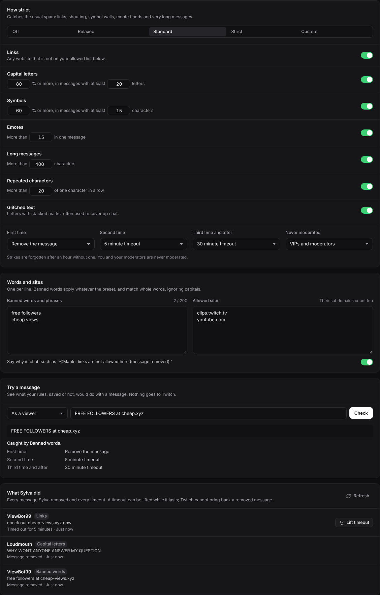

## Loyalty

Off until the streamer turns it on. Viewers earn points, named whatever the streamer likes (leaves, acorns), and check them in chat.

* **Earning.** Every 5 minutes while live, each viewer in chat earns the watch amount (10 by default), and those who chatted in that time earn the chat amount on top (5). A follow pays once per viewer (50), a sub or resub pays the subscriber (250), each gifted sub pays the gifter (100), and every 100 bits pay 50. Each amount can be set from 0 to 100,000. The streamer and the bot never earn, and a line removed by moderation earns nothing.
* **Who is watching.** Twitch only shows viewers who do not chat through its chatter list, which needs `moderator:read:chatters`. Until the streamer allows it (Allow chat list, kept as its own encrypted grant like moderation), only viewers who chatted are paid. The list is read up to 5,000 viewers.
* **Chat commands**, answered while the chat bot is on: `!points` (or the points' own name) shows a balance and rank, with `@name` for someone else's; `!top` lists the five with the most; `!give @name 100` passes points to another viewer when the streamer allows it; `!addpoints @name 100` (or `-100`) is for moderators and finds viewers by their Twitch name even before they have earned anything. Viewers wait 5 seconds between checks.
* **History.** Every change is kept with its reason, such as Followed, Cheered or Gift from Hazel. Watch payments in a row add up into one line. A balance never drops below zero. The dashboard lists every viewer, most first, with search, their history and a way to add or take away points with a reason.

`GET` and `POST /v1/channels/{key}/loyalty` hold the settings; `GET .../loyalty/viewers?q=` lists viewers, `POST .../loyalty/viewers/{id}/adjust` changes a balance and `GET .../loyalty/viewers/{id}/ledger` is the history.

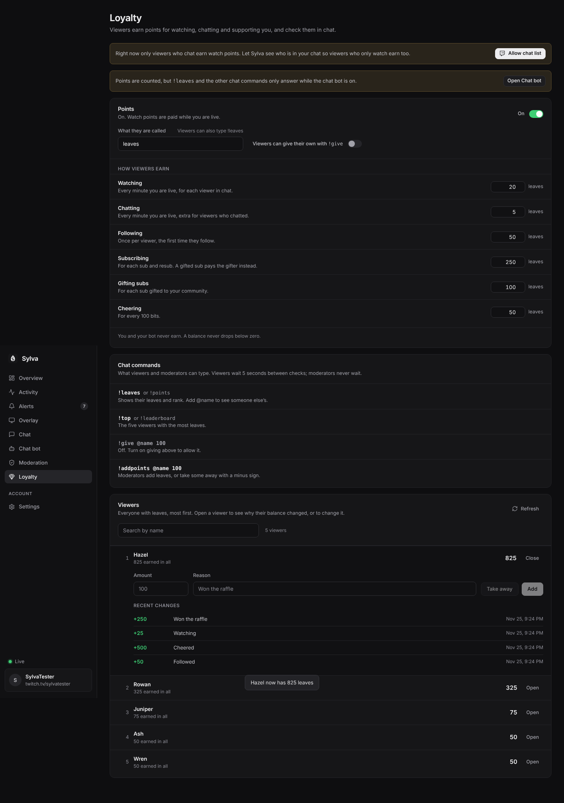

### Games

Once points are on, viewers can bet them in chat. Every game starts on, and each has its own switch on the Loyalty page, with a smallest bet, a largest bet (0 for no limit) and the seconds a viewer waits between games (30 by default). A bet can be a number, `2k`, `half`, `25%` or `all`.

- `!gamble 100`: rolls 1 to 100. 56 or more doubles the bet, and 100 pays four times.
- `!roulette 100 red`: red, black, even, odd, green or a number 0 to 36. A single number pays 35 to 1. Without a pick it bets on red.
- `!slots 100`: three reels of six symbols. Three of a kind pays 10 times (20 for 💎), two of a kind gives back 1.5 times.
- `!blackjack 100` (or `!bj`), then `!hit` or `!stand`. The bet is taken at the deal. Blackjack pays 3 to 2 and the dealer stands on 17. A hand left for 2 minutes stands on the viewer's next blackjack command.
- `!duel @name 100`: the other viewer has 2 minutes to `!accept` or `!deny`. Both need the bet; the winner takes it.

`!raffle` works like StreamElements': a moderator types `!raffle` (for the maximum amount) or `!raffle 1000`, viewers type `!join`, and when the time is up one of them wins points that Sylva creates. The Raffle card on the Loyalty page has its switch (on by default) and, under Edit, the duration (30 seconds), the maximum amount (3,000) and the start, running and end messages with `{points}`, `{pointsname}`, `{time}` and `{winner}`. The running message goes out halfway through raffles of 20 seconds or more. Its changes save by themselves. A giveaway open with the keyword `join` takes `!join` first, so new giveaways start with `enter`.

The game words count as Sylva's own, so a giveaway cannot use them. A custom command with the same name still wins.

## Points store

Rewards viewers buy with loyalty points. Closed until the streamer opens it, and it needs points on.

* **Rewards** have a name, a cost (1 to 10,000,000), an optional description, an optional limited stock, a wait per viewer between buys (none up to a week), and optionally a message the viewer must add, such as a song name. A reward can be hidden without deleting it. Names cannot start with a number, since chat reads that as a reward's place in the list.
* **In chat**, `!store` (or `!rewards`) lists them with their numbers and the public page's link; `!redeem 2` or `!redeem song request` buys one, with the message after it. Sylva answers when the reward is sold out, the viewer must still wait, the message is missing, or the viewer has too few points, and otherwise takes the points and says so.
* **The queue** on the Store page lists what is waiting, oldest first, with the viewer's message. Done moves it to History (with Undo), and Refund gives the points back and returns a limited reward to the stock.
* **The public page** at `/s/{twitch name}` shows the rewards, the top ten, and lets a viewer look up their points. It works for any channel with points on, and says so plainly otherwise.

`GET` and `POST /v1/channels/{key}/loyalty/store` hold the rewards, `GET .../loyalty/redemptions?status=pending|done` is the queue and history, and `POST .../loyalty/redemptions/{id}/done`, `.../reopen` and `.../refund` settle one. `GET /v1/public/{login}` is the public page's data and needs no sign in.

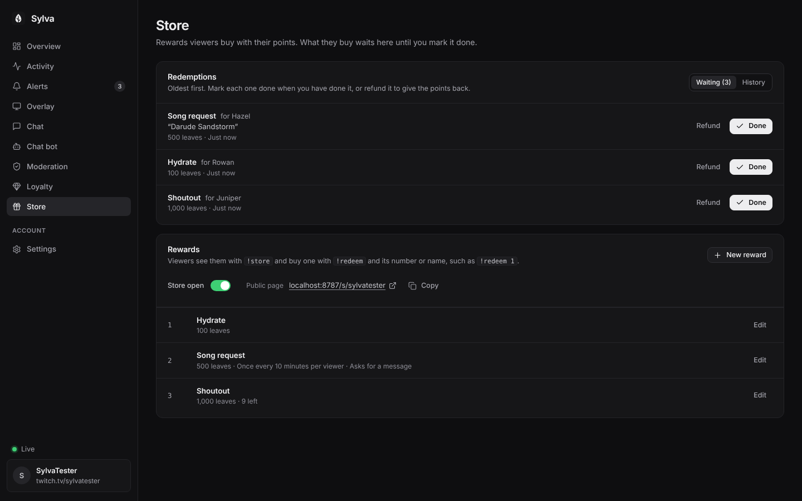
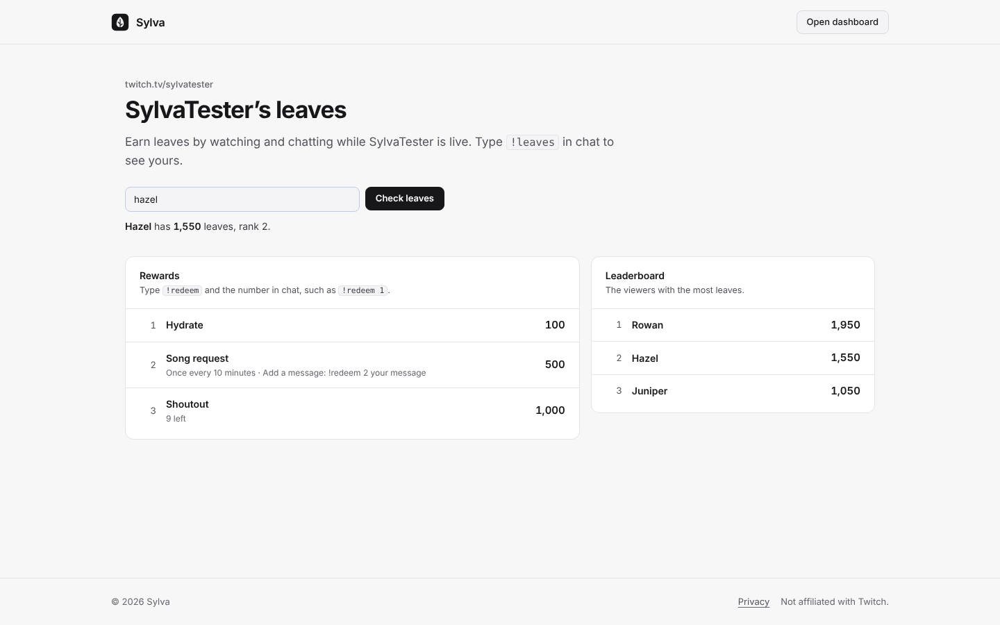

## Giveaways

Viewers enter with a word in chat, and the streamer draws when ready. One giveaway runs at a time.

* **Starting one** takes a prize, the chat word (such as `join`, so viewers type `!join`), who can enter (everyone, subscribers, VIPs or moderators), subscriber luck (subscribers, VIPs and moderators get up to 5 tickets instead of 1), and an entry cost in loyalty points (needs points on). Words Sylva already answers to, such as a command, a counter, `points` or `redeem`, are refused. Sylva posts the giveaway in chat when the bot is on.
* **Entries** are silent so chat stays readable: one per viewer, the streamer never enters, and a viewer short of points is told once. The page shows the newest 500 and refreshes every few seconds. Up to 50,000 entries are taken.
* **Drawing** closes entries and posts the winner in chat. Draw another picks again, never someone who already won. Finish ends it. Cancel, before anyone wins, gives every entry cost back.
* **Fair draws.** When a giveaway opens, Sylva picks a secret seed and shows its SHA-256 hash. The seed itself is shown after the first draw, so anyone can check it matches the hash and was fixed before anyone entered. Winner number N is found by hashing `seed:N` with SHA-256, reading the first 8 bytes as a number (big endian), taking it modulo the total tickets, and counting through the entries in the order they came in, skipping earlier winners.
* The last 50 giveaways are kept with their winners and seeds.

`GET` and `POST /v1/channels/{key}/giveaways` read and start them, and `POST .../giveaways/{id}/close`, `.../draw`, `.../end` and `.../cancel` run the current one.

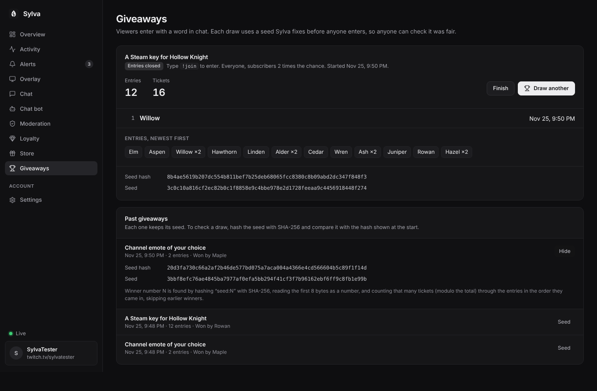

## Team

The owner adds people who help run the channel. Each signs in to Sylva with their own Twitch account and finds the channel next to their own, in a channel picker at the bottom of the sidebar.

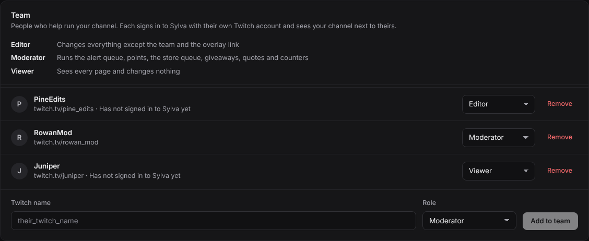

* **Roles.** An **Editor** changes everything except the team and the overlay link (a new link would break the owner's OBS). A **Moderator** runs the live parts: the alert queue (pause, mute, skip, replay), lifting timeouts, adding and taking away points, the store queue, giveaways, quotes, counters and the test chats. Everything else is read only for them. A **Viewer** sees every page and changes nothing. Up to 25 people.
* **Adding someone** takes their Twitch name and a role, on Settings. They can be added before they ever sign in to Sylva. Changing a role or removing someone applies on their next click, with no sign out needed.
* **What teammates see.** A line at the top of every page says what their role can do, settings they cannot change are greyed out, and the overlay page explains why its links stay with the owner and editors. Permissions that only the owner can give Twitch, such as Allow moderation, are left to the owner.
* **The server decides.** Every channel request is checked against the role (`sylva_core::team::allows`), so hiding a button is a courtesy, not the protection.

The team is stored in the directory, keyed by Twitch user, and each teammate's account keeps a copy of its roles, refreshed at every sign in and on every change, so ordinary requests never ask the directory. `GET /v1/channels/{key}/team`, `POST .../team` (`{"login": "name", "role": "editor"}`) and `POST .../team/{id}/remove` manage it, for the owner only.

## Widgets

Every widget is the overlay page with `&widget=` added to the same private link, so one token covers them all and New links replaces them all at once. Each is its own Browser Source in OBS, at the size the dashboard shows.

| Widget | Link adds | Shows |
| --- | --- | --- |
| Alert box | nothing | Alerts, one at a time, as set in Alerts. |
| Event list | `&widget=feed` (`&limit=` 1 to 20, default 5) | The newest follows, subs, gifts, cheers, raids, tips and redemptions. |
| Latest label | `&widget=latest&kind=follow` (or `subscriber`, `communityGift`, `cheer`, `raid`) | One line with the latest of that kind. |
| Top label | `&widget=top&kind=cheer` (or `communityGift`) | The top cheerer or gifter since the stream went live (or the last 24 hours when Sylva has not seen it go live). |
| Goal bar | `&widget=goal` | The goal set on the Overlay page: followers, subs (new, resubs and each gifted sub) or bits, counted from when it was started. |
| Chat box | `&widget=chat` (`&limit=` 1 to 30, default 12) | Chat lines as they arrive. |

Widgets connect with the `widget` role: on connect they get a `widgets` frame (recent events, the latest of each kind, recent chat and the goal with its progress) and then follow live `event` frames, plus `top` frames when the top cheerer or gifter may have changed. A `?scene` overlay also gets the published layout in the `widgets` frame, and a new one whenever it is published. They never receive `play` frames and do not count as connected alert boxes, so they cannot hold up the alert queue. Saving the goal sends a fresh `widgets` frame to every widget on screen. The goal lives in `GET` and `POST /v1/channels/{key}/widget-settings`.

### Built-in widgets

The editor's starting template is two built-in custom code widgets: pill
alerts over the whole canvas (they play the alert queue) and a Twitch-style
chat. Add widget, Alert box and Chat box insert them too. The chat shows
Twitch badges and Twitch, 7TV, BetterTTV and FrankerFaceZ emotes, which the
overlay reads from `GET /v1/chat-assets/{channel}` (public, cached an hour)
and hands to every custom widget the way StreamElements does.

The overlay page carries the same code (the Worker puts it into the page from
`web/src/widgets`), so the stock alert box and chat box are gone everywhere:
a scene item of kind `alerts` or `chat`, the plain alert link and the
`&widget=chat` link all show the built-in widgets, and a channel that has not
published a layout shows both. The editor opens a never published channel on
the default template and turns old alert box and chat box items into the
built-in widgets in the draft.

### Custom code widgets

The overlay editor's **Add widget > Custom code** places the streamer's own HTML, CSS and JavaScript on the canvas. It is plain web code, the same thing OBS's browser runs, so there is no build step and nothing extra to load. **Edit code** opens an editor with HTML, CSS, JavaScript and Fields tabs, a live preview at the widget's size, and buttons that send a test follow, sub, gift, cheer, raid or chat line.

Each one runs in a sandboxed frame (`/overlay-frame`, served with `Content-Security-Policy: sandbox allow-scripts`), so its code has an origin of its own: it cannot read Sylva's cookies, the overlay link or the page around it, and a broken widget cannot break the rest of the overlay. It may load fonts, images and libraries from anywhere.

The code gets `Sylva`:

- `Sylva.fields`: the widget's settings, by key.
- `Sylva.data`: what the overlay knows now (`recent`, `latest`, `top`, `chat`, `goal`).
- `Sylva.on(type, fn)`: `'event'` for every live event, a kind such as `'follow'`, `'subscriber'`, `'communityGift'`, `'cheer'`, `'raid'`, `'tip'`, `'redemption'` or `'chat'`, and `'data'` and `'top'`.
- In alert mode, `Sylva.on('alert', fn)` gets `{ id, event, view }` and `Sylva.done()` moves the queue on. A widget that plays alerts takes the alert box's place, so a scene has one or the other. If it never calls `done()`, the overlay moves on 15 seconds after the alert's time.

StreamElements custom widgets can be pasted in: the Fields tab takes their JSON as is, `{{field}}` placeholders are filled in HTML, CSS and JavaScript, and `onWidgetLoad`, `onEventReceived` (follower, subscriber, cheer, raid, tip and message listeners) and `SE_API.resumeQueue()` work. `SE_API.store` and counters answer with nothing.

A widget holds up to 100 KB of code, and a scene's custom widgets up to 400 KB together. For the smoothest motion, animate `transform` and `opacity` with CSS.
