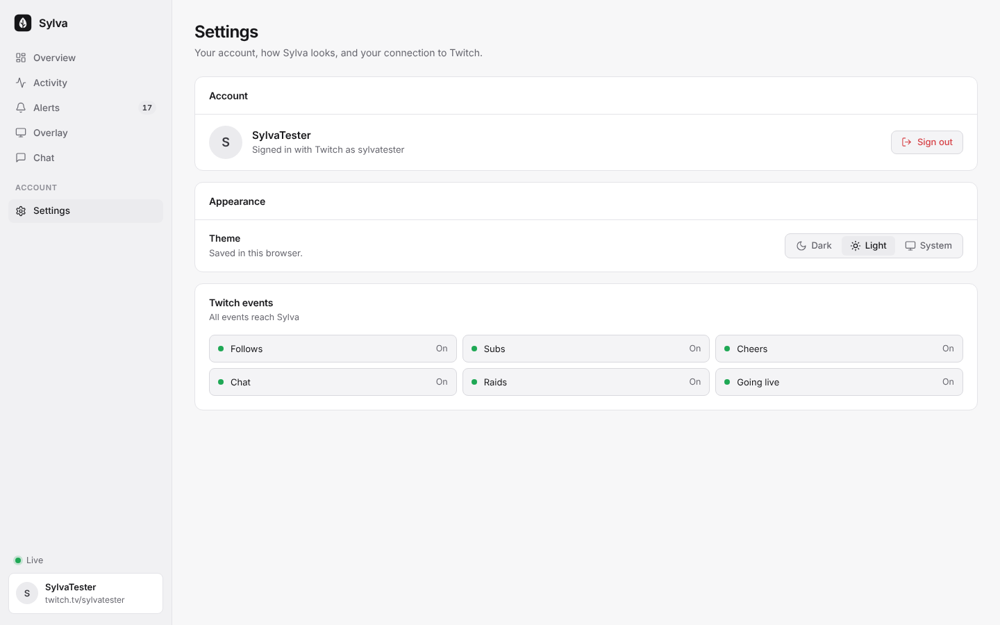

# The Sylva website

Sylva is a website, not a desktop window. It has two parts, served by the same Worker from one origin.

## The landing page, `/`

What Sylva is, what it does, and three steps to start, with Continue with Twitch at the top and bottom. If a sign in fails, the reason shows under the button. Signed in visitors see Open dashboard instead. Unknown pages show a short Page not found.

## The dashboard, `/app`

A sidebar with the pages, the live connection and the signed in channel. On phones the sidebar becomes a drawer behind a menu button. Every page has its own address, so links, reloads and the back button work. Visiting `/app` signed out goes to the landing page, and signing in lands on `/app`.

| Page | Path | What it is for |
| --- | --- | --- |
| Overview | `/app` | The last 24 hours (followers, subs, bits, raids), a setup checklist until the overlay and a test alert are done, recent activity, alert controls and chat. |
| Activity | `/app/activity` | Every event, newest first, with filters by kind, search by name or message, and Show older. Search runs on the server, so it covers all history. |
| Alerts | `/app/alerts` | Mute, pause, skip, and a test alert for each kind, plus Replay on recent alerts. |
| Overlay | `/app/overlay` | The overlay link (hidden until copied), Open, New link, and the steps for OBS. |
| Chat | `/app/chat` | Chat, live and read only. |
| Settings | `/app/settings` | The account and Sign out, the theme (Dark, Light or System), and which Twitch events reach Sylva. |

## Design

The look takes Cortex's ideas, not its layout: neutral grays, one color per kind of event used everywhere that kind appears, flat cards with 1 px borders, Inter with tabular numbers, a white primary button, and short calm motion. Dark is the default. The light theme uses the same tokens with lighter values, and the choice is applied before the page paints, so it never flashes.

## How it was checked

* Every page driven in Chromium with Playwright at 1440 px and at 390 px (phone), in both themes: sign in through the fake Twitch, live events, search, theme change, the phone drawer, and sign out. No page scrolls sideways on a phone.
* `npm run test:e2e` adds a check for history search: names and messages match regardless of case, and `%` and `_` are taken literally.
