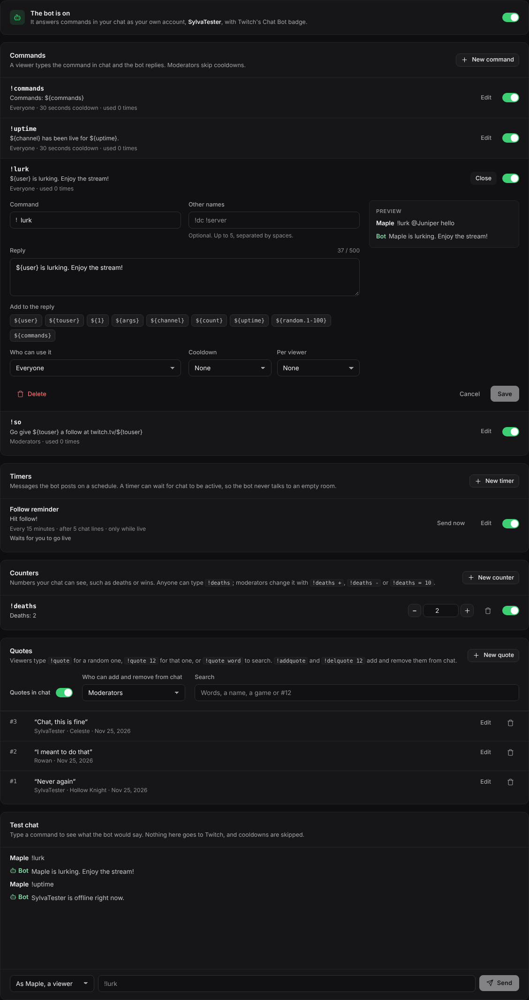

# The Sylva website

Sylva is a website, not a desktop window. It has two parts, served by the same Worker from one origin.

## The landing page, `/`

What Sylva is, what it does, and three steps to start, with Continue with Twitch at the top and bottom. If a sign in fails, the reason shows under the button. Signed in visitors see Open dashboard instead. Unknown pages show a short Page not found.

## Other public pages

* `/privacy`: what Sylva keeps, why, who can see it, where it is stored, and how to delete it. Linked from every public page's footer and from Delete account.
* `/device`: where a streamer approves an app such as Cortex (see [api.md](api.md)).

## Deleting an account

Settings, Delete account, then type the Twitch name to confirm. `POST /v1/account/delete` (browser session and same origin only; the body is `{"confirm": "<twitch login>"}`):

1. Asks Twitch to stop every EventSub subscription for the user. If Twitch does not confirm, nothing is deleted and the page says to try again.
2. Erases the account (identities, sessions, API tokens), every channel it owns (events, alerts, settings, goal, overlay links; open overlays are closed) and its directory entries, so signing in again starts a fresh account.
3. Revokes the Twitch token and clears the cookie. The browser lands on `/` with a note that the account was deleted.

## The dashboard, `/app`

A sidebar with the pages, the live connection and the signed in channel. On phones the sidebar becomes a drawer behind a menu button. Every page has its own address, so links, reloads and the back button work. Visiting `/app` signed out goes to the landing page, and signing in lands on `/app`.

| Page | Path | What it is for |
| --- | --- | --- |
| Overview | `/app` | The last 24 hours (followers, subs, bits, raids), a setup checklist until the overlay and a test alert are done, recent activity, alert controls and chat. |
| Activity | `/app/activity` | Every event, newest first, with filters by kind, search by name or message, and Show older. Search runs on the server, so it covers all history. |
| Alerts | `/app/alerts` | Mute, pause and skip; alert types (on or off, minimum amount, time on screen, label and message, with a live preview); a test alert for each kind; Replay on recent alerts. |
| Overlay | `/app/overlay` | The overlay editor (every widget on one canvas, published to one link), the goal, single widget links for anyone who prefers one source per widget, New links, and the steps for OBS. |
| Chat | `/app/chat` | Chat, live and read only. |
| Chat bot | `/app/bot` | Turn the bot on, edit its commands, timers, counters and quotes, and a test chat that shows what it would answer. |
| Moderation | `/app/moderation` | How strict chat rules are (Off, Relaxed, Standard, Strict or Custom), each rule with its limits, banned words and allowed sites, a box to try a message, and the log of what Sylva did with Lift timeout. |
| Loyalty | `/app/loyalty` | Turn points on, name them, set what each way of earning pays, the chat commands, and every viewer with their balance, history and a way to add or take away points. |
| Settings | `/app/settings` | The account and Sign out, the theme (Dark, Light or System), connected apps, which Twitch events reach Sylva, and Delete account. |

## Design

The look takes Cortex's ideas, not its layout: neutral grays, one color per kind of event used everywhere that kind appears, flat cards with 1 px borders, Inter with tabular numbers, a white primary button, and short calm motion. Dark is the default. The light theme uses the same tokens with lighter values, and the choice is applied before the page paints, so it never flashes.

## How it was checked

* Accessibility: axe finds no WCAG 2.1 AA issues on 64 page states (every page in both themes, the alert editor, the overlay editor with each menu open and a widget selected, the chat bot with a command open, a new command, the test chat, a timer open and a new timer, a new counter and a new quote, moderation with unsaved changes and a tried message, and moderation off, loyalty with unsaved changes and a viewer open, search, device approval, the phone drawer, privacy and the delete form). Text contrast is at least 4.5 to 1. The phone drawer moves focus in and back out and makes the page behind it inert.
* Security headers: the website sends a Content-Security-Policy with its one inline script allowed by hash, `X-Frame-Options: DENY`, `Referrer-Policy` and `Permissions-Policy`. `app.js` and `index.css` are linked with a content hash and cached for a year.

* Every page driven in Chromium with Playwright at 1440 px and at 390 px (phone), in both themes: sign in through the fake Twitch, live events, search, theme change, the phone drawer, and sign out. No page scrolls sideways on a phone.
* `npm run test:e2e` adds a check for history search: names and messages match regardless of case, and `%` and `_` are taken literally.
* It checks the chat bot against the fake Twitch: off by default, levels, cooldowns, moderators skipping them, aliases, counts a save cannot change, echoes ignored, the test chat sending nothing, moderation (permission missing, allowing it, refreshing an expired token, keeping it after a plain sign in, delete then timeout, who is skipped, spaced notices, lifting a timeout, and refusing to undo a removed message), counters and quotes (only moderators change them, values a save cannot reset, numbers never reused, Undo restoring a quote's number, the test chat changing nothing, quotes turned off), and timers (refused variables, waiting for chat lines and for going live, going live restarting them, Send now, the bot's own posts not counting as chat, and Send now refused while the bot is off), and loyalty points (one follow bonus however often someone follows, subs, gifts and cheers, watch and chat points paid only while live, viewers who only watch paid once the chat list is allowed, the streamer never paid, `!points`, `!top`, `!give` with too few points, `!addpoints` for moderators only and for viewers Sylva has not seen yet, balances stopping at zero, the dashboard's search, changes and history, and turning points off). When a timer is due is covered by unit tests.
* It also checks the overlay editor (bad layouts are refused, drafts are tidied, publishing pushes the layout to overlays on screen, versions and restore work) and top labels (cheers add up per viewer and reach widgets live).

## Alert types

Each kind of alert (follows, subs, gifted subs, cheers, raids, tips, channel points) has:

* **On or off.** Off still records the event in Activity; it just does not play.
* **Play from** a minimum amount, for kinds with an amount: bits, raid viewers, subs in a gift, tip amount. Smaller ones only go to Activity.
* **On screen for** 2 to 20 seconds.
* **Label and message.** The message can use `{name}`, `{amount}` and, for channel points, `{reward}`.
* **Show what the viewer wrote**, for cheers, subs and tips.

The channel applies these on the server (`crates/sylva-core/src/alerts.rs`): it decides what goes into the queue, and every `play` frame carries the finished text and time on screen, so all overlays show the same thing and old overlay links need no change. A `duration` in an overlay link still overrides the time for that overlay. Test alerts follow the settings too, and the dashboard says when a test only went to Activity.

## The overlay editor

The top of the Overlay page. Every widget sits on one 1920 by 1080 canvas, and the whole layout is one Browser Source in OBS: the overlay link with `&scene` added.

* **Add widget** places an alert box, event list, latest label, top label, goal bar or chat box (one alert box per layout). **Templates** starts from Gameplay, Just chatting or Minimal. **Try it** sends a test event, so an open overlay shows the alert and its labels update. The previews on the canvas use example names.
* Drag to move, pull a corner to resize. Widgets snap to the canvas edges and centers and to each other, with guides; hold Alt to place freely. Arrow keys nudge by 1 px (Shift for 10), Delete removes, Escape deselects, and Undo and Redo work with Ctrl+Z and Ctrl+Shift+Z.
* The panel beside the canvas sets exact position and size, the kind for latest and top labels, how many rows for the event list and chat, and the stacking order.
* Changes save as a draft on their own. **Publish** makes a new version and every open overlay switches to it at once. **History** keeps the last 20 published versions; Restore to draft brings one back to check before publishing it again.

The draft and versions live in the channel's Durable Object (`GET /v1/channels/{key}/scene`, `POST .../scene` for the draft, `POST .../scene/publish`, `POST .../scene/restore/{version}`). The server checks every layout: known widgets only, unique ids, sizes kept on the canvas, at most 24 widgets.

## The chat bot

Off until the streamer turns it on. When a chat line starts with `!` and names a command, the channel's Durable Object checks who may use it and its cooldowns, counts it, writes the reply and sends it with Twitch's Send Chat Message API and Sylva's app token. The `user:bot` and `channel:bot` scopes granted at sign in are what Twitch needs for that, and the reply shows Twitch's Chat Bot badge.

* **Who replies.** The streamer's own account by default, so it works with no setup. A shared Sylva bot account replies instead once `SYLVA_BOT_USER_ID` and `SYLVA_BOT_LOGIN` are set: sign in to that account at `/auth/twitch/bot` (it asks only for `user:bot`) and it shows the two values.
* **Commands.** Every channel starts with `!commands`, `!uptime`, `!lurk` and `!so` (moderators), which are ordinary commands to change or delete. A command has other names, a reply of up to 500 characters, who may use it (everyone, subscribers, VIPs, moderators, or only the streamer) and cooldowns for everyone and per viewer. Moderators skip cooldowns. Up to 100 commands.
* **Variables** use StreamElements' style so imported commands keep working: `${user}`, `${touser}`, `${1}` to `${9}`, `${args}`, `${channel}`, `${count}`, `${uptime}`, `${random.1-100}` and `${commands}`. A reply with `${uptime}` while offline says the channel is offline. Unknown variables are refused when saving.
* **Test chat** runs a line through the same code on the server without sending it, as a viewer, subscriber, VIP, moderator or the streamer. The editor's preview uses it too, with the unsaved command.
* **Echoes.** The bot remembers what it sent for a minute, so its own reply coming back through chat is never read as a command.
* Deleting a command or a timer offers Undo.

### Timers

Messages the bot posts on a schedule, such as a follow reminder or a Discord link. Up to 20.

* **When.** Every 5 minutes to 3 hours, and only once at least a set number of chat lines (0 to 100) have been sent since the last post, so the bot never talks to an empty room. Lines the bot sent itself do not count. A timer can post only while live (the default) or at any time.
* **How.** The channel's Durable Object keeps one alarm for both alerts and timers, set for whichever is due first. Due timers post one at a time, at least 30 seconds apart. Going live restarts every timer's clock, so nothing fires the moment a stream starts.
* **Variables.** `${channel}`, `${uptime}`, `${commands}` and `${random.1-100}`. Variables about a viewer are refused, because no viewer started the message.
* **The list** shows each timer's rule and what it waits for: the next post time, more chat lines, going live, or the bot being turned on. Send now posts it at once and restarts its clock.

### Counters and quotes

* **Counters** are numbers chat can see, such as deaths. `!deaths` shows `Deaths: 6` (at most every 5 seconds, except for moderators). Moderators change it with `!deaths +`, `!deaths -2`, `!deaths = 10` or `!deaths reset`; the dashboard has minus and plus buttons and the number itself. Up to 30. The value is the server's, so a settings save cannot reset it.
* **Quotes** are numbered: `!quote` picks one at random, `!quote 12` shows that one, `!quote word` picks among the quotes that mention the word, the speaker or the game. `!addquote words` adds one (with the game Twitch last reported) and `!delquote 12` removes one; moderators may by default, and the page can change that. Numbers are never reused. The dashboard lists, searches, adds, edits and removes quotes, with Undo putting a quote back under its number. Up to 2,000.
* A counter or quotes cannot share a name with a command; the save says which to rename.

`GET` and `POST /v1/channels/{key}/bot` hold the settings (use counts and counter values are the server's and a save cannot change them); `POST .../bot/try` is the test chat; `POST .../bot/timers/{id}/send` is Send now.

## Moderation

Off until the streamer picks a preset. Each chat line is checked in the channel's Durable Object before the bot sees it; a line that breaks a rule gets no bot answer.

* **Presets.** Relaxed catches links, banned words and glitched text, and trusts subscribers. Standard adds capital letters (80% of 20 letters or more), symbols (60% of 15 characters), more than 15 emotes, more than 400 characters and more than 20 of one character in a row. Strict tightens those (60% of 12, 40% of 10, 8 emotes, 250 characters, 12 in a row). Changing any rule makes it Custom. A named preset always carries its own rules, so what the page shows is what runs.
* **What happens.** Standard and Relaxed remove the message the first time and time out after that (5 then 30 minutes for Standard, 1 then 10 for Relaxed); Strict times out from the first time (1 minute, 10, then an hour). Strikes are forgotten after an hour without one, and only actions Twitch carried out count. The streamer, moderators and the chosen levels are never moderated.
* **Links** are anything with `http`, `www.` or a common top level domain (`spam.xyz`, `bit.ly/x`); `ok.so` and `v1.2.3` are chat. Allowed sites and their subdomains pass. **Banned words** match whole words and phrases, ignoring capitals. **Caps and symbols** ignore emotes, using the fragments Twitch sends.
* **Notices.** Optionally the bot says why, such as "@Maple, links are not allowed here (message removed).", at most one every 10 seconds so a spam wave does not become a wall of notices.
* **Permission.** Twitch lets only a moderator remove messages and time people out, with their own token. Sign in asks for no more than before; Allow moderation goes to Twitch once more with `moderator:manage:chat_messages` and `moderator:manage:banned_users`. Those tokens are stored as a separate grant (encrypted), so a later plain sign in does not take moderation away. The channel refreshes the token when it runs out, and the page says when Twitch no longer accepts it.
* **The log** keeps the last 500 actions. A timeout can be lifted while it lasts, which also forgives that strike. Twitch cannot bring back a removed message, and the page says so.

`GET` and `POST /v1/channels/{key}/moderation` hold the settings, `POST .../moderation/try` checks a message, `GET .../moderation/log` and `POST .../moderation/log/{id}/undo` are the log.

## Loyalty

Off until the streamer turns it on. Viewers earn points, named whatever the streamer likes (leaves, acorns), and check them in chat.

* **Earning.** Every 5 minutes while live, each viewer in chat earns the watch amount (10 by default), and those who chatted in that time earn the chat amount on top (5). A follow pays once per viewer (50), a sub or resub pays the subscriber (250), each gifted sub pays the gifter (100), and every 100 bits pay 50. Each amount can be set from 0 to 100,000. The streamer and the bot never earn, and a line removed by moderation earns nothing.
* **Who is watching.** Twitch only shows viewers who do not chat through its chatter list, which needs `moderator:read:chatters`. Until the streamer allows it (Allow chat list, kept as its own encrypted grant like moderation), only viewers who chatted are paid. The list is read up to 5,000 viewers.
* **Chat commands**, answered while the chat bot is on: `!points` (or the points' own name) shows a balance and rank, with `@name` for someone else's; `!top` lists the five with the most; `!give @name 100` passes points to another viewer when the streamer allows it; `!addpoints @name 100` (or `-100`) is for moderators and finds viewers by their Twitch name even before they have earned anything. Viewers wait 5 seconds between checks.
* **History.** Every change is kept with its reason, such as Followed, Cheered or Gift from Hazel. Watch payments in a row add up into one line. A balance never drops below zero. The dashboard lists every viewer, most first, with search, their history and a way to add or take away points with a reason.

`GET` and `POST /v1/channels/{key}/loyalty` hold the settings; `GET .../loyalty/viewers?q=` lists viewers, `POST .../loyalty/viewers/{id}/adjust` changes a balance and `GET .../loyalty/viewers/{id}/ledger` is the history.

## Widgets

Every widget is the overlay page with `&widget=` added to the same private link, so one token covers them all and New links replaces them all at once. Each is its own Browser Source in OBS, at the size the dashboard shows.

| Widget | Link adds | Shows |
| --- | --- | --- |
| Alert box | nothing | Alerts, one at a time, as set in Alerts. |
| Event list | `&widget=feed` (`&limit=` 1 to 20, default 5) | The newest follows, subs, gifts, cheers, raids, tips and redemptions. |
| Latest label | `&widget=latest&kind=follow` (or `subscriber`, `communityGift`, `cheer`, `raid`) | One line with the latest of that kind. |
| Top label | `&widget=top&kind=cheer` (or `communityGift`) | The top cheerer or gifter since the stream went live (or the last 24 hours when Sylva has not seen it go live). |
| Goal bar | `&widget=goal` | The goal set on the Overlay page: followers, subs (new, resubs and each gifted sub) or bits, counted from when it was started. |
| Chat box | `&widget=chat` (`&limit=` 1 to 30, default 12) | Chat lines as they arrive. |

Widgets connect with the `widget` role: on connect they get a `widgets` frame (recent events, the latest of each kind, recent chat and the goal with its progress) and then follow live `event` frames, plus `top` frames when the top cheerer or gifter may have changed. A `?scene` overlay also gets the published layout in the `widgets` frame, and a new one whenever it is published. They never receive `play` frames and do not count as connected alert boxes, so they cannot hold up the alert queue. Saving the goal sends a fresh `widgets` frame to every widget on screen. The goal lives in `GET` and `POST /v1/channels/{key}/widget-settings`.

